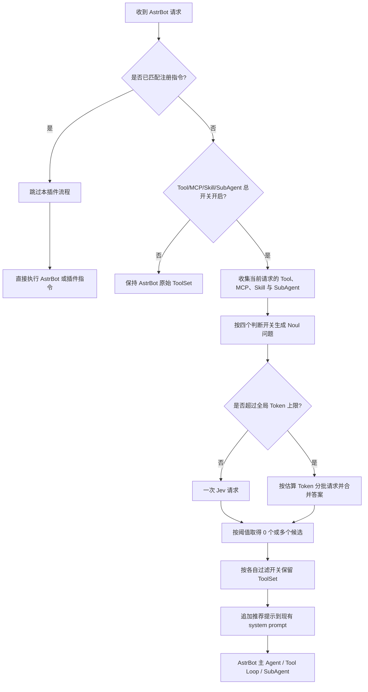
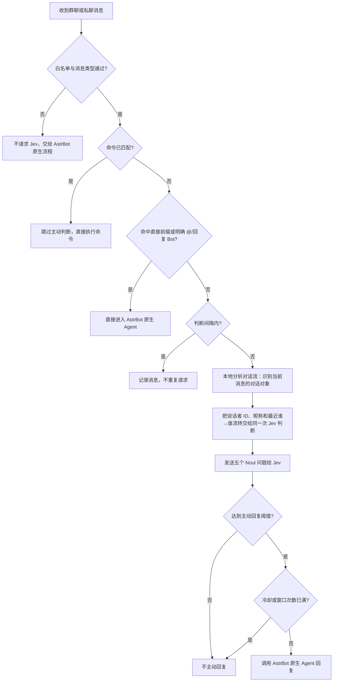
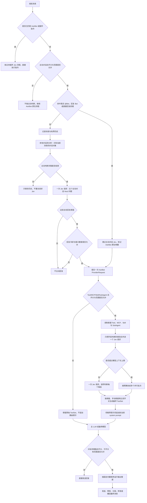
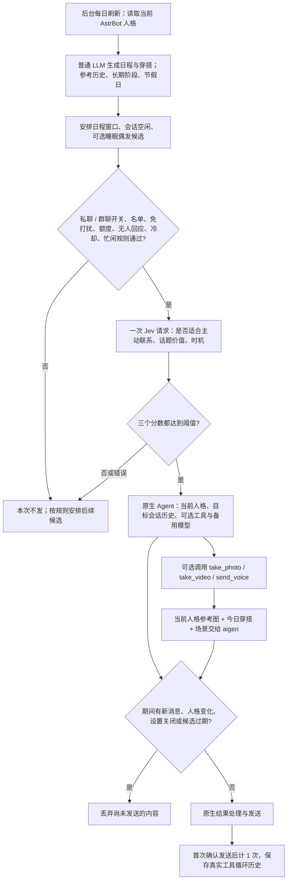

# jev决策综合插件

`jev决策综合插件` 是一个适用于 [AstrBot](https://github.com/AstrBotDevs/AstrBot) 的 Jev/SystemOne 决策插件。它在 AstrBot 把请求交给主 LLM 之前，先判断当前场景真正需要哪些 Tool、MCP 工具、Skill 和 SubAgent，必要时过滤掉无关能力，或者把候选写入主 LLM 的推荐提示词；它也能判断机器人是否适合接话，并为当前 AstrBot 人格生成日程、穿搭与长期生活阶段，在指定会话中经 Jev 判断后主动联系。

最终回答、工具执行和人格沿用 AstrBot 原生 Agent。新增的虚拟生活负责维护日程与状态，由 Jev 判断主动发起是否合适；拍照、拍视频与生音频统一通过 aigen 的公开工具接口生成。原独立的人际网络插件已并入本插件，人物、关系与共同经历按人格保存，并在对话前注入关系上下文。插件不会替换 AstrBot 的人格提示词，也不会覆盖其他插件追加到 system prompt 的内容。

## 你第一次安装时应该先知道什么

这个插件有两层配置：

- AstrBot 原生插件配置页只放全局服务参数和三个总开关。
- 插件详情页 WebUI 放 Tool、MCP、Skill、SubAgent、提示词、消息接话范围、主动发起开关与名单、虚拟生活、多媒体生成、外貌参考图、人际网络和详细策略。

安装后的推荐顺序是：

1. 安装并启用插件。
2. 在 AstrBot 原生配置页填写 Jev 服务地址、路径、API 密钥和模型。
3. 打开需要使用的总开关：“Tool/MCP/Skill/SubAgent 决策”“主动对话”“对话流增强”。
4. 进入插件 WebUI，保存 Tool/MCP/Skill/SubAgent 和主动对话的详细规则。
5. 用 AstrBot 的插件热重载使原生全局参数重新初始化；WebUI 详细设置保存后会立即用于后续请求。

服务地址默认留空，不会预置任何第三方地址。API 密钥只应填写在 AstrBot 的密钥字段中，不要写进 README、截图、日志或 Git 提交。

## 功能概览

| 功能 | 做什么 | 是否改变 AstrBot 原生回答链 |
| --- | --- | --- |
| Tool 判断 | 让 Jev 逐项判断普通 Tool 是否适合当前请求 | 只调整本次请求可见的 ToolSet，并追加推荐提示 |
| MCP 判断 | 让 Jev 逐项判断每个 MCP 工具是否适合当前请求 | 与 Tool 相同，独立控制判断、过滤、保留和推荐 |
| Skill 判断 | 让 Jev 逐项判断每个 Skill 是否适合当前请求 | 控制 AstrBot 注入主 LLM 的 Skill 清单，并追加推荐提示 |
| SubAgent 判断 | 让 Jev 逐项判断是否值得委派给每个 SubAgent | 只调整本次请求可见的 handoff，并追加推荐提示 |
| `jev_decide` | 让主 LLM 按需调用 Jev 做一次 noul、choice 或 score 判断 | 不执行其他工具 |
| 消息接话 | 收到消息后判断 Bot 是否适合参与，支持独立黑白名单 | 满足条件后调用 AstrBot 原生 Agent |
| 主动发起 | 按日程窗口、空闲时间、睡眠偶发窗口产生候选，经 Jev 决定是否主动联系 | 沿用当前人格、原生工具循环和备用模型 |
| 虚拟生活 | 每日日程、穿搭、长期阶段、节假日、创意池、状态注入、可选回复等待 | 日程内容由配置的普通 LLM 生成 |
| 多媒体生成 | 人格外貌参考图 + 今日穿搭 + 当前活动，通过 aigen 生成照片、短视频或音频并发送；拍摄对象可以是本人、他人、景物、物品，也可以是手机截图或录屏 | 提供 `take_photo`、`take_video`、`send_voice` 三个工具，各自独立开关 |
| 人际网络 | 按人格维护人物、关系与共同经历，按姓名、别名或代词注入关系上下文 | 已并入本插件；提供 `update_personal_network`、`query_personal_network` 工具和 `/关系查询` 命令 |
| WebUI | 管理规则、提示词、工具来源和白名单 | 不替换 AstrBot 主 LLM 人格 |

## 主流程

Tool、MCP、Skill 和 SubAgent 判断会合并为一个 Jev 请求。没有超过上下文上限时只有一次请求，超过上限才分批；每个候选仍然独立判断，可以选中 0 个、1 个或多个。



命中已注册的 AstrBot 内置指令或插件指令时，AstrBot 的 waking-check 已经产生 `handlers_parsed_params`，插件会在主动判断和 LLM 工具路由处直接返回，不会让 Jev 延迟或改变指令执行。没有命中注册指令的 `/xxx` 只是普通文本；默认 `/` 是直接唤醒前缀，它可能进入 AstrBot 原生 Agent，此时 Agent 请求仍会经过 Tool/MCP/Skill/SubAgent 决策。

## 安装

### AstrBot 插件市场

1. 打开 AstrBot 管理面板的插件市场。
2. 搜索 `jev决策综合插件`，也可以搜索仓库名 `astrbot_plugin_decision`。
3. 安装并启用插件。
4. 打开原生配置页填写全局服务参数，再打开插件 WebUI 保存详细策略。

### GitHub 或手动安装

在 AstrBot 项目目录执行：

```bash
cd /root/yiyin/AstrBot
git clone https://github.com/yiyinfaith/astrbot_plugin_decision.git data/plugins/astrbot_plugin_decision
```

更新已有代码：

```bash
cd /root/yiyin/AstrBot/data/plugins/astrbot_plugin_decision
git pull --ff-only
```

手动复制时，目标目录必须是：

```text
<AstrBot>/data/plugins/astrbot_plugin_decision/
```

安装器会读取 `requirements.txt` 安装依赖；手动安装需在 AstrBot 使用的 Python 环境安装它，新增依赖包括 APScheduler 3、holidays、lunar_python 和 Pillow。

至少应包含 `main.py`、`_conf_schema.json`、`metadata.yaml`、`decision/`、`pages/` 和 `logo.png`。安装或更新后使用插件热重载，不需要重启整个 AstrBot。

## 第一步：配置全局参数

AstrBot 原生插件配置页中的项目如下：

| 配置项 | 默认值 | 作用 |
| --- | ---: | --- |
| 决策服务 | `systemone_jev` | 当前使用的决策 Provider |
| 服务地址 | 空 | Jev 服务基础 URL，例如 `https://example.com` |
| API 路径 | `/v1/systemone` | SystemOne 请求路径 |
| API 密钥 | 空 | Jev 服务密钥，AstrBot 会遮罩保存 |
| Jev 模型 | `jev-latest` | 发送给服务端的模型名 |
| 请求超时 | `5` 秒 | 每次 Jev 请求的超时时间 |
| 最大重试次数 | `1` | 首次失败后的额外重试次数；`0` 表示不重试 |
| 重试间隔 | `0` 秒 | 默认失败后立即重试 |
| 上下文上限 | `32000` Token | 主动对话超限时裁剪旧历史；Tool/MCP/Skill/SubAgent 超限时分批 |
| 上下文消息数 | `8` | Tool/MCP/Skill/SubAgent 判断使用的最多历史消息数 |
| 上下文字符数 | `6000` | Tool/MCP/Skill/SubAgent 判断状态中的历史字符上限 |
| Tool/MCP/Skill/SubAgent 决策 | 开启 | 整个 Tool/MCP/Skill/SubAgent 决策链总开关，不影响主动对话 |
| 主动对话 | 关闭 | 消息接话与主动发起的模块总开关；主动发起本身还要由 WebUI 的“启用私聊主动 / 启用群聊主动”决定，详细规则在 WebUI |
| 对话流增强 | 开启 | 输入增强和输出增强的总开关，详细配置在 WebUI |

服务地址和 API 路径会直接拼接成请求地址。服务地址填写 `https://example.com` 时，API 路径填写 `/v1/systemone`，不要把完整路径重复填写两次。

SystemOne 客户端默认只对超时、网络错误、429 和 5xx 重试；401/403、其他 4xx 和响应解析错误不会盲目重试。客户端会把单次请求超时至少限制为 1 秒。

## 第二步：配置插件 WebUI

WebUI 分为“Tool/MCP/Skill/SubAgent 决策”“主动对话”“对话流增强”三个区域。页面使用 Vue 3 和 Goose liquid-glass 组件；Goose 或 WebGL 不可用时会回退到原生控件，仍可查看和保存。原生配置页的三个总开关分别控制这三个区域；区域里的输入增强、输出增强开关只控制各自子功能。

### Tool、MCP、Skill 与 SubAgent：判断和过滤

普通 Tool、MCP、Skill 和 SubAgent 各有一个“判断”开关和一个“过滤”开关。四类开关可以使用不同组合，但 Jev 判断问题会合并处理。

| 判断 | 过滤 | 交给主 LLM 的能力 | 注入推荐提示词 |
| --- | --- | --- | --- |
| 开启 | 开启 | Jev 选中项 + “始终保留”项 | Jev 选中项 + “始终推荐给主 LLM”项 |
| 开启 | 关闭 | 全量保留 | Jev 选中项 + “始终推荐给主 LLM”项 |
| 关闭 | 开启 | 仅“始终保留”项 | 仅“始终推荐给主 LLM”项 |
| 关闭 | 关闭 | 全量保留 | 仅“始终推荐给主 LLM”项 |

“判断”决定是否把该类别送给 Jev；“过滤”只决定是否从本次交给主 LLM 的 ToolSet 中移除未保留候选。判断关闭时不会请求 Jev，但仍按该类别自己的过滤开关执行：过滤开只留手动保留，过滤关全量保留。

当前默认值是：判断 Tool 开、过滤 Tool 开；判断 MCP 开、过滤 MCP 开；判断 Skill 开、过滤 Skill 开；判断 SubAgent 开、过滤 SubAgent 关。这个默认组合会过滤 Tool、MCP 和 Skill，但让 SubAgent 全量可见，同时仍利用 Jev 生成四类能力推荐。

整个 Tool/MCP/Skill/SubAgent 决策区域还有一个独立的会话范围黑白名单：

- **黑名单模式（默认）**：名单内的群聊、私聊用户或完整 `unified_msg_origin` 不进行 Tool/MCP/Skill/SubAgent 决策；名单为空时全部应用。
- **白名单模式**：只对名单内会话进行 Tool/MCP/Skill/SubAgent 决策；名单为空时全部不应用。

范围不适用时，插件不会请求 Jev、不会过滤 ToolSet，也不会追加推荐提示词，AstrBot 会按原始能力集合继续处理请求。这个范围只控制 Tool/MCP/Skill/SubAgent 决策，不影响主动对话或对话流增强。

### Tool/MCP/Skill/SubAgent 决策

每个 Tool、MCP 工具、Skill 和 SubAgent 都有两个独立选项：

- **始终保留**：即使 Jev 没选中，过滤开启时也继续交给主 LLM。
- **始终推荐给主 LLM**：把该能力名称写入主 LLM 的推荐提示词。必须先勾选“始终保留”。

Jev 选中的候选会自动进入推荐提示词；仅勾选“始终保留”的候选只会保留，不会被插件主动推荐。MCP、Skill 和 SubAgent 的配置分别位于 WebUI 对应区域，不会与其他类别的手动列表混用。

Skill 不是函数工具，而是 AstrBot 注入 system prompt 的 `SKILL.md` 能力清单。插件会把 Skill 清单和其他三类能力放进同一次 Jev 判断；过滤开启时只保留 Jev 选中项和“始终保留”项，再从 AstrBot 已生成的 `## Skills` 区块中移除其他条目，不会改动人格或其他插件的 system prompt。Skill 的来源按 `SkillInfo.plugin_name` 归属插件；没有插件归属的本地、工作区或沙箱 Skill 单独显示为“Skill”。

列表会显示能力来源。同一插件的 Tool、MCP 或 Skill 会放在同一分组中；没有插件归属的 MCP 单独归为“MCP”，没有插件归属的 Skill 单独归为“Skill”。AstrBot 内置 Tool 显示为“Astrbot内置工具”并默认排在底部。首次打开页面时，内置 Tool 和 `jev_decide` 默认“始终保留”，默认不勾选“始终推荐给主 LLM”。

### `jev_decide` 工具

插件通过 `Context.add_llm_tools()` 注册 `jev_decide`，供主 LLM 按需调用。它不会执行其他工具，只向 Jev 请求一次结构化判断，支持：

- `decision_type`: `noul`、`choice` 或 `score`；
- `state`、`instructions`；
- `choice_options`: 至少两个 `{key, description}` 选项；
- `score_levels`: 有序评分等级。

`jev_decide` 的来源显示为“jev决策综合插件”，不是 AstrBot 内置工具。它默认始终保留，但默认不始终推荐给主 LLM。

### 两套提示词

WebUI 提供两套可编辑提示词：

1. **Jev 判断前提示词**：只发送给 Jev，说明它应该怎样做结构化判断，不会把主 LLM 人格 system prompt 原样发送给 Jev。
2. **判断后注入主 LLM 的提示词**：在 Jev 判断结束后追加到当前请求的 system prompt，支持 `{tools}`、`{mcps}`、`{skills}` 和 `{subagents}` 占位符。

插件只追加自己拥有的 `<astrbot_plugin_decision_routing>` 区块，不替换原有 system prompt。AstrBot 人格、其他插件追加的提示词和备用模型切换都会继续保留。

### Jev 失败时

Tool/MCP/Skill/SubAgent 请求失败时插件采用 fail-open，避免服务故障导致 AstrBot 无法正常聊天：四类能力都会保持全量可见；普通 Tool 过滤开启时仍会按原有规则移除未保留的 `jev_decide`，除非勾选了“始终保留”。手动“始终推荐给主 LLM”在 Jev 失败时仍会注入推荐提示词。

## 主动对话

WebUI 仍是三个并列区域。主动对话内有两个子页：**消息接话**处理收到的消息，**主动发起**处理没有新消息时的主动联系。原生“主动对话”总开关管理二者，子页各有独立开关。下面的接话黑白名单只控制“消息接话”；主动发起使用 **私聊主动 / 群聊主动** 各自的开关与名单，避免把黑名单空列表误当成向所有会话主动发送。

### 消息接话范围

每行填写一个值，支持：

- 群聊 ID：只匹配群聊；
- 私聊用户 ID：只匹配私聊发送者；
- 完整 `unified_msg_origin`：精确区分平台和会话。

主动对话范围有一个独立的黑白名单模式开关：

- **白名单模式**：只对列表内的群聊、私聊用户或完整 `unified_msg_origin` 启用主动对话；列表为空时全部不应用；
- **黑名单模式**：列表内不启用主动对话；列表为空时全部应用。

范围不通过、消息不是群聊或私聊时，插件不会发起主动判断，AstrBot 原生聊天照常处理。

### 消息接话流程



一次普通主动判断会同时询问五个维度：是否在有意义地对 Bot 说话、现在插话是否自然、Bot 是否能提供相关价值、时机是否合适、回复是否能自然延续对话。默认权重为指向 `1.4`、介入 `1.4`、相关价值 `1.2`、时机 `0.8`、连续性 `0.8`。

### 一次消息的完整处理流程

下面的流程图把命令、主动对话、Tool/MCP/Skill/SubAgent 决策、主 LLM 和输出增强串在一起：



### 对话流增强：输入与输出

“对话流增强”有独立的范围黑白名单，规则与主动对话范围相同。它不会复用主动对话的名单。原生“对话流增强”总开关关闭时，输入和输出两个子模块都会停止；总开关开启后，再分别由 WebUI 内的子开关决定是否执行：

- **输入增强**：对话流分析开关和窗口大小。根据 @、引用回复、机器人最近回复、发送者 ID 和最近消息判断“谁在和谁说话”，并把方向信息加入主动判断上下文；这一步完全在本地完成，不增加 Jev 请求；
- **输出增强**：内置兼容管道，在发送前按阶梯处理消息。WebUI 已完整提供原 OutputPro 的配置项，按“图片外显与报错、消息拦截、艾特处理、文本清洗、文本替换、错字模拟、文转语音、文转图片、智能引用与合并转发、自动撤回、分段回复”分组；每一步可单独开关，原插件中的列表、阈值、概率、路径和文本选项都能在这里编辑。

如果服务器上仍然启用了独立的 `astrbot_plugin_outputpro`，请关闭其中一个插件的输出增强，避免两个发送前管道重复清洗或重复分段。

### 对话流分析：识别谁在和谁说话

主动判断前会先在本地做一次轻量、无需额外模型请求的对话流分析。它只使用 AstrBot 事件里的发送者 ID、昵称、@ 节点、引用回复和本插件保存的最近消息，不会搬入 `context_aware` 的图像转述、历史压缩、人格注入或其他功能。

判断优先级如下：

1. 明确 @Bot：当前消息指向 Bot；
2. 明确 @其他人：当前消息指向被 @ 的用户；
3. 引用回复：当前消息指向被引用消息的发送者；
4. Bot 在 20 秒内刚刚回复当前用户且当前消息像“好的/谢谢/收到”等短确认：暂时认为是在回应 Bot；如果 Bot 插话前另一位用户正在和该用户对话，则回到那条人际对话；
5. A-B-A：只有上一条消息明确指向当前用户时才推断具体对象；单纯“紧接着发言”不算证据，否则保守标记为“群聊”。

发送者 ID 是身份依据，昵称只用于可读显示，因此重名或改名不会把两个人合并；这借鉴了 `maskoff` 的稳定 ID 思路，但不会搬入它的昵称映射警告功能。分析结果会和最近的 `发送者（ID）→ 对象（ID/名称）` 对话流一起放进现有主动判断请求；不会增加 Jev 请求次数。关闭 WebUI 中的“对话流分析”后，主动判断恢复为原来的纯文本历史模式。

默认满足以下任一条件才会主动回复：

- 加权综合分 `>= 0.68`；
- 指向 Bot `>= 0.70` 且适合介入 `>= 0.85`。

显式 @Bot 或回复 Bot 且“强制回复”开启时，会旁路主动对话 Jev，直接进入 AstrBot 原生 Agent；这个 Agent 请求仍会触发 Tool/MCP/Skill/SubAgent 决策。命中昵称别名 `AI|助手` 只是增加“被指向”上下文，仍会走主动判断。

### 前缀和节流参数

- 直接回复前缀默认 `/` 和 `@`。
- 普通前缀要求消息文本以该前缀开头。
- `@` 只识别真正的 @Bot 消息节点，不把普通文本中的 `@` 当作唤醒。
- 成功判断后的默认判断间隔为 `3` 秒；间隔内的新消息会记录进有界历史，但不会每条都请求 Jev。
- Jev 请求在所有重试都失败后也会进入这个判断间隔，并按现有失败次数逐步放大，避免服务故障时每条消息都重复请求；单次请求内部的重试间隔仍由全局“重试间隔”控制，默认立即重试。
- 回复冷却默认 `60` 秒，回复窗口默认 `600` 秒，窗口最多回复 `2` 次。
- 历史消息数默认 `12`，最多会话数默认 `500`。
- 复读、密集对话、最少参与人数和观测超时用于更新会话状态，不会替代最终 Jev 判断。

主动对话 WebUI 参数速查：

| 参数 | 默认值 | 影响 |
| --- | ---: | --- |
| 范围模式与列表 | 白名单 / 空 | 白名单空时全部不应用；黑名单空时全部应用。每行一个群聊 ID、私聊用户 ID 或 `unified_msg_origin` |
| 直接回复前缀 | `/`、`@` | 普通前缀从消息开头匹配；`@` 只匹配真实 @Bot 节点 |
| 强制回复 | 开启 | 明确 @Bot 或回复 Bot 时绕过主动 Jev，直接进入原生 Agent |
| 对话流分析 | 开启 | 输入增强的本地“谁在和谁说话”分析 |
| 对话流窗口 | `8` 条 | 参与对话对象推断并提供给 Jev 的最近消息条数 |
| 机器人昵称 | `AI\|助手` | 命中昵称时标记为可能被指向，但仍需 Jev 判断 |
| 综合介入阈值 | `0.68` | 五项加权综合分达到此值才主动回复 |
| 直接指向阈值 | `0.70` | 与自然介入阈值组成另一条满足即回复的路径 |
| 自然介入阈值 | `0.85` | 与直接指向阈值同时达到时主动回复 |
| 判断间隔 | `3` 秒 | 成功判断后，间隔内消息只进历史，不重复请求 Jev |
| 回复冷却 | `60` 秒 | 两次主动回复之间的最短间隔 |
| 回复窗口 / 最多回复 | `600` 秒 / `2` 次 | 限制一个时间窗口内的主动回复次数 |
| 历史消息数 / 最多会话数 | `12` / `500` | 控制主动对话内存和发送给 Jev 的历史规模 |
| 观测超时 | `600` 秒 | 长时间没有消息后重置会话观测状态 |
| 复读检测 | `3` 条 / `30` 秒 | 判断重复消息并更新熟悉阶段状态 |
| 密集对话 | `30` 条 / `600` 秒 / `2` 人 | 判断多人高密度聊天并更新熟悉阶段状态 |

输出增强的配置位于 WebUI 的“对话流增强 → 输出增强”区域。勾选输出阶梯后始终按内置顺序执行；用户只能启用或停用步骤，不能修改执行顺序。样式目录默认使用 `data/plugins/astrbot_plugin_decision/outputboost/t2i_style`，运行时会优先复用服务器上已有的旧 OutputPro 样式目录。报错处理中的自定义消息留空时只转发报错并保留原消息；输出处理失败时也会自动保留原消息，不会阻断 AstrBot。

如果 AstrBot 原生 `provider_ltm_settings.active_reply.enable` 已开启，插件会关闭自己的 ambient 主动判断，避免两套主动回复机制重复触发。明确命令、前缀和原生唤醒仍由 AstrBot 正常处理。

## 主动发起：给当前人格一套持续的虚拟生活

这一部分整合了 Virtual Life v1.12.2 的核心。**默认不会主动发出任何生活消息**：私聊主动默认开启但群聊主动默认关闭，而两类名单默认为空、默认又是白名单模式（空白名单 = 全部不发起）；回复延迟同样默认关闭。安装和更新不会自动向群聊或私聊发送生活消息。无需同时启用原版 Virtual Life；同时运行两套主动发起可能重复发送。

### 首次设置

1. 在 AstrBot 原生配置中开启“主动对话”。如果只需要定时联系，可以在 WebUI 关闭“消息接话”。
2. 在目标群聊或私聊运行 AstrBot `/sid`，复制完整会话标识，例如 `aiocqhttp:FriendMessage:123456`。平台前缀以实际 `/sid` 输出为准。
3. 打开 **主动对话 → 主动发起**，展开“私聊主动”或“群聊主动”，打开 **启用私聊主动** / **启用群聊主动**。**没有全局“启用主动发起”开关**：主动发起只由这两个按类型的开关控制，任一为开且原生“主动对话”总开关为开时后台才会运行。名单模式决定下方名单的含义：默认是白名单（只有名单内会话会主动发起，名单为空时全部不发起），可切换为黑名单（名单内会话不主动发起，名单为空时全部发起）。名单每行填写一个完整 UMO；两类名单分别填写。
4. 选择日程模型，可留空使用 AstrBot 默认模型；主动消息模型留空时使用目标会话当前模型。人格始终按 AstrBot 最终生效的人格规则读取，没有独立人格覆盖配置。
5. 先保持默认冷却、额度、无人回应和免打扰设置，点击“保存全部设置”。后台会恢复 / 生成今天的生活计划并安排未来任务。
6. 在“今日生活与外貌”的可搜索会话下拉中选择目标会话，点击“读取生活与外貌”查看当前人格；生成 / 重写操作使用**已经保存**的配置。没有发送权限或日程生成失败时，检查“运行与操作结果”。

群聊名单与私聊名单是主动发送的明确对象清单。只填写用户 ID 或群号是不够的，因为无人发言时插件无法可靠推断平台与目标类型。消息接话的黑白名单继续支持简写 ID。

WebUI 的“请求立即发起”和 `/生活 立即` 使用与自动任务相同的会话类型开关、名单、免打扰、冷却、日额度、连续未回应上限和 Jev 阈值；被策略拒绝时不会发送。管理员操作不会绕过这些限制。

### 私聊 / 群聊名单模式

`私聊主动` 与 `群聊主动` 各自有一个 **名单模式** 开关（`friend_settings.session_blacklist` / `group_settings.session_blacklist`），它决定下方名单（`session_list`）的含义。默认是白名单：

| 模式 | 名单非空 | 名单为空 |
| --- | --- | --- |
| 白名单（默认，`session_blacklist = false`） | 只有名单内的会话会主动发起 | **全部会话都不主动发起** |
| 黑名单（`session_blacklist = true`） | 名单内的会话不主动发起 | 全部会话都会主动发起 |

名单每行一个完整 UMO，且只能填对应类型：私聊名单只接受 `FriendMessage`，群聊名单只接受 `GroupMessage`。名单模式与按类型开关是两件事：`enable` 关闭时该类型完全不主动发起，与名单内容无关。黑名单模式下插件无法枚举“全部会话”，因此后台只对已经出现过的会话安排候选。

### 主动发起流程



**Jev 只做结构化判断，日程和消息由普通 LLM 生成。**主动发起的三个问题合并为一次 Jev 请求，并复用全局 5 秒超时、1 次额外重试、0 秒重试间隔和上下文上限。过长历史裁掉最旧部分；判断提示词与当前事实会保留，固定内容本身超限时放弃本次发送并记录原因。图片不会被上传给 Jev。

工具能力决策是原生 Agent 的另一个阶段：如果开启了 Tool/MCP/Skill/SubAgent 判断，会再进行该阶段的合并 Jev 请求。一次主动发起的整个流程因此可能有“是否开口”和“使用哪些能力”两次不同用途的 Jev 调用。

### 完整配置分组

原版的配置分组与全部字段都在 WebUI，列表每行一个值，长提示词可直接编辑。以下说明各组的用途：

| 分组 | 作用与主要参数 |
| --- | --- |
| 主动发起与 Jev | 判断阈值、免打扰起止、平台失败后暂停、候选有效期、后台并发、判断提示词。这里**没有**总开关；是否主动发起由“私聊主动 / 群聊主动”决定 |
| 虚拟日程 | 日程 / 穿搭独立生成、每日生成时间、日程和主动消息模型、历史参考 / 保留天数、结构校验后的额外重试次数 |
| 多媒体生成 | 多媒体总开关、`take_photo` / `take_video` / `send_voice` 三个按类型开关、照片 / 视频比例、视频时长、生成冷却、每会话每日提交上限、主动发起计费账户、三项主动发起概率、三组数量上下限、音频模式与音色、三套提示词模板 |
| 外貌参考图补充 | 外貌补充描述（只用于补充说明参考图中人物的外貌与参考穿搭）、“无今日穿搭时沿用参考图穿搭”；参考图本身按人格在上方卡片上传 |
| 人际网络 | 已并入本插件，无需再安装 `astrbot_plugin_personal_network`：启用开关、LLM 更新 / 查询工具开关、关系网生成模型、代词回溯与匹配规则、注入位置与各项上限、已完成日程经历回写、新人物生成概率、当前时段参与者注入；默认关闭 |
| 提示词与模板 | 日程系统词、完整生成模板、日程模板、穿搭系统词 / 模板、校验失败重试模板；默认词内置身份 / 日期 / 校服一致性自检，模板新增 `{appearance_context}` 占位符 |
| 日程创意池 | 主题、心情和穿搭风格池，为不同日期提供变化 |
| 大时间表 | 长期阶段开关、续期重试间隔和次数；自然语言草稿、JSON 导入、批准和拒绝操作在页面下方 |
| 图片设置 | 日程 / 穿搭 / 阶段图片渲染、主题、宽度和字体；渲染失败自动回退文字 |
| 普通回复延迟 | 日程忙闲公式、最大等待、活跃会话保护时间、公开原因和等待通知模板，默认关闭 |
| 智能注入 | 当前活动基础模块、字符上限、长期里程碑天数、穿搭 / 日程 / 长期阶段关键词；只读已缓存状态，不为每句话生成日程 |
| 私聊主动 / 群聊主动 | 各自的启用开关（**主动发起只由这两个开关控制**）、名单模式（白名单 / 黑名单）、UMO 名单、空闲时间上下限、冷却、每日基础预算、日程模型预算加成与每日硬上限 |
| 发送限制 | 连续未回应上限、睡眠偶发概率与“跳过免打扰”开关、忙闲概率、窗口最低空闲时间、时间抖动、窗口补发与次数、日程上下文、历史说明、未回应语气与分段设置 |

### 关键参数怎样影响发送

| 参数 | 默认 | 实际影响 |
| --- | --- | --- |
| Jev 阈值 | `0.7` | 三个维度都要达到；提高后更少主动联系 |
| 免打扰 | `23:00–07:00` | 禁止主动发起；开始结束设成相同时间表示不设置这个时段限制 |
| 后台最大并发 | `2` | 限制生活生成 / 发送任务并发；普通消息不会为此每次重新生成计划 |
| 候选有效期 | `30` 分钟 | 从开始判断到发送的最长有效期；新消息、人格变化、关闭设置也会使未发送内容失效 |
| 平台失败暂停 | `30` 分钟 | 连续请求 / 发送异常后暂缓该平台候选；恢复收到消息时清除暂停 |
| 私聊空闲 / 冷却 | `90–240` / `120` 分钟 | 空闲候选从最后一次消息开始计时，发送后冷却单独计算 |
| 私聊预算 / 加成 / 硬上限 | `1–3` / `2` / `5` | 每日基础预算确定后可加日程额度，最终不超过硬上限；不是保证发满 |
| 群聊空闲 / 冷却 | `45–120` / `60` 分钟 | 群里有人持续聊天会重置空闲时间；日程窗口也需满足空闲要求 |
| 群聊预算 / 加成 / 硬上限 | `0–1` / `1` / `2` | 群聊默认更克制，“启用群聊主动”默认关闭 |
| 连续未回应上限 | `3` | 连续多少条主动消息都没回复后暂停；对方回一句就清零。私聊来信重置；群聊无关闲聊不会重置，明确 @ / 回复 Bot 才重置 |
| 最低窗口空闲 | `20` 分钟 | 日程窗口到点也不直接打断热聊；可配置因冷却 / 不够空闲而重排窗口及次数 |
| 窗口时间抖动 | `15` 分钟 | 避免每天完全相同的机械时点，仍受其它规则限制 |
| 睡眠偶发概率 | `0.08` | 偶尔生成起夜 / 失眠候选，仍需 Jev、额度检查；免打扰由“睡眠偶发唤醒跳过免打扰”控制（默认开），设为 `0` 关闭 |
| 日程生成重试 | `2` | 普通模型输出 JSON 不合法时额外修复尝试，与全局 Jev 重试设置分开 |

日程、穿搭按人格和日期共享；额度、冷却、未回应按会话隔离。第一段消息或媒体确认发送后，本次主动发起只计 **1 次**；后续分段失败也不会把已经送达的联系当作“没发过”。全部未发送成功时不扣发送次数。

回复延迟仅在主动发起可用并显式开启此项时应用，使用缓存日程的忙闲状态计算等待时间，可合并等待期间消息。**已注册指令、直接回复前缀、明确 @ / 回复 Bot 立即进入原生处理，不进入生活等待**。延迟提示可关闭，WebUI 可手动结算当前等待批次。分段发送优先服从 AstrBot 原生或输出增强的分段规则，避免重复拆分。

### 长期阶段与未来要求

- 自然语言生成追加 / 替换草稿，在 WebUI 检查后批准；未批准草稿不改变已批准阶段。拒绝时可在补充要求框填写修改意见后重写。
- JSON 导入使用原版阶段结构，仍走结构校验和草稿批准。阶段列表、当前阶段详情均可渲染图片。
- 支持按校历、项目工期、自定义阶段扩展到每天，结合节假日生成生活日程；阶段结束后的续期按配置重试。
- 未来日期 / 区间的一次性要求只在该日首次成功生成时消费；不能修改已经有有效日程的日期。范围示例 `2026-12-01..2026-12-03`。
- 原版的大量命令未重复注册。只保留 `/生活 状态`（只显示当前会话状态）、`/生活 日程`、`/生活 穿搭`、`/生活 立即`（管理员）。最后一项仍经过名单、额度和 Jev，不是强制群发。生成、审批、导入等集中在 WebUI。
- 另有 `get_virtual_daily_schedule`、`get_long_term_timeline`、`add_schedule_requirement` 三个查询 / 安排工具；添加要求只允许管理员。工具仍受 AstrBot 人格权限和本插件 Tool 决策规则控制。

### 日程与穿搭的人格一致性规则

`提示词与模板` 分组里的默认提示词内置了一组“身份与场景一致性”自检项，用于防止日程和穿搭与人格设定穿帮。它们是提示词内容，可以在 WebUI 中修改：

- **身份一致**：先判断主体的身份类型（中小学生、大学生、教职工、上班族、自由职业、退休、无业等），年龄、性别、居住地、家庭成员必须来自人格设定；地点与活动也要符合该身份与所在环境。
- **日期一致**：工作日、周末与法定节假日必须区别对待；节假日不排课程与上班，工作日不排与身份冲突的“全天宅家”安排。
- **校服规则**：中小学（含小学、初中、高中）在**上学日**必须穿校服；**大学不穿校服**；任何身份在周末、寒暑假与法定节假日都不穿校服。穿搭提示词还要求中小学上学日必须是校服风格（含校服外套、运动服、校鞋等），不得是便装或时装。
- **禁止矛盾内容**：不得出现与人格设定冲突的服饰或活动（例如男性人格生成裙装、学生生成职业套装、儿童生成高跟鞋）。
- **外貌参考说明**：若提示中给出了外貌参考说明，把它作为该人格的默认外观与参考穿搭基调，但当天场合优先。

`完整生成提示模板`、`单独生成日程提示模板` 和 `单独生成穿搭提示模板` 都新增了 `{appearance_context}` 占位符，内容来自 **外貌参考图补充 → 外貌补充描述**（`appearance_settings.description`）；留空时填入“无（未填写外貌补充描述；若有外貌参考图，请以参考图为准）”。原有的 `{mode}`、`{date}`、`{weekday}`、`{holiday}`、`{persona}` 等占位符继续可用。

### aigen 联动：照片、短视频与音频

1. 安装并启用 [astrbot_plugin_aigen](https://github.com/yiyinfaith/astrbot_plugin_aigen)，先配置可正常使用的生图 / 生视频服务；生音频需要 aigen 提供 `generate_audio`，否则 `send_voice` 会直接说明而不提交任务。Decision 复用它的模型、任务与发送能力，不复制密钥或预设。
2. 在 **主动发起 → 外貌参考图（按人格）** 卡片中选择目标人格，上传这个人格的外貌参考图。支持 PNG / JPEG / WebP，每张最多 8MB、2500 万像素、每人格最多 5 张；参考图按人格保存，与具体会话无关，同人格的其它会话共享这些参考图。
3. 保持每日穿搭生成开启，生成 / 重写今日穿搭。照片与视频提示词会组合参考图、外貌补充、**今日穿搭**、当前活动、工具参数里的拍摄场景；参考图用于保持脸、发色、瞳色等外貌，旧衣服由今日穿搭覆盖。
4. 在 Tool 管理中保留 `take_photo` / `take_video` / `send_voice`，并在 **多媒体生成** 分组中打开对应的按类型开关（`send_voice` 默认关闭）。如果希望主动发起 Agent 每次都知道这些能力，可分别勾“始终保留”和“始终推荐给主 LLM”；人格本身也要允许使用。模型自行决定合适时才调用。

三个工具都接受 `count`，用于一次生成多张 / 多段；数量会被再次钳制到管理员配置的区间内（见下文“主动发起附带多媒体”）。

```text
take_photo(scene="坐在书店窗边，手里拿着刚读完的小说", subject="self", count=1)
take_photo(subject="screenshot", scene="和朋友的聊天记录界面")
take_video(scene="在河畔散步，向镜头挥手，衣服与今日穿搭一致", subject="scene")
send_voice(text="今天路过一家很好吃的面包店", style="轻快地分享")
```

`subject` 取值与含义（仅影响提示词组装，不改变 aigen 调用）：

| `subject` | 含义 |
| --- | --- |
| `self`（默认） | 自己 |
| `other` | 别人 |
| `scene` | 眼前的景色 / 环境 |
| `object` | 身边的物品 |
| `screenshot` | 手机屏幕内容（截图或录屏），用于 `take_photo` 生成截图、`take_video` 生成录屏 |

照片默认 `3:4`；视频默认 `9:16`、`5` 秒；生成冷却 `60` 秒，每会话每日最多 **5 个实际媒体单位**：照片按实际照片张数，视频按实际视频段数，音频按实际音频段数计算。这是 Decision 的安全额度，不是金额计费；金额、账户余额和模型价格表达式全部由 aigen 负责。aigen 会把媒体发送到当前会话，工具随后返回客观状态，让主 LLM 自然继续；Decision 不再额外调用一个模型补写回复。

手动聊天中也可使用这三个工具，不要求开启后台主动发起。未安装 aigen、未上传当前人格参考图时，返回清楚原因而不提交媒体生成。今日穿搭缺失时，若 **外貌参考图补充 → 无今日穿搭时沿用参考图穿搭**（`appearance_settings.use_reference_outfit`）为开，照片与视频会沿用参考图中的服装；关闭则直接提示先生成今日穿搭。任务可能收费，因此调用 aigen 前会临时预占本次请求的媒体单位额度；成功、部分成功、取消和未提交会按实际完成单位结算安全额度。金额不会在 Decision 内重复计算，aigen 的计费账户、模型价格和视频实际秒数规则保持原样。请求异常时不自动重试，先到 aigen 查询任务状态再决定下一步。提示词要求能减少服饰冲突，最终图像 / 视频一致性仍取决于 aigen 所用模型。

### 主动发起附带多媒体：概率、种类与数量

主动发起时是否附带多媒体，由 **多媒体生成** 分组中的三项概率与三个按类型开关共同决定，逻辑是“独立掷骰 → 最多选一种 → 数量交给模型 → 工具再钳制”：

1. 先收集可用种类：`photo` / `video` / `audio`，条件是多媒体总开关 `enable` 为真、该种类开关为真、且该种类概率大于 `0`。
2. 对每个可用种类**独立掷骰**：`random.random() < probability`。三个概率互不影响，可以同时命中。
3. 若没有任何种类命中，本次主动发起不附带多媒体，派发提示词也不追加任何媒体指令。
4. 若命中 ≥1 个，**只挑一种**：以各自的概率为权重做一次加权随机，因此一条主动消息不会同时混发多种媒体。
5. 把选中的种类、工具名和数量区间写进派发提示词（例如“数量必须 1~3 张”）；数量由模型在区间内自行决定，模型也可以判断此刻不适合而不发。
6. 工具内部再用 `clamp_count` 把 `count` 钳制回同一区间，防止模型越界；区间为 `0` 时等于不生成。每次决策都会写日志便于排查。

因此概率只影响“是否附带”和“挑中哪一种”，不保证一定发出；数量上下限只约束区间，不代表每次都会生成上限张数。三项概率默认都是 `0.0`，即默认不附带任何多媒体。

### 主动发起多媒体由谁付费

aigen 按「平台名 + 发送者 ID」记账（`["aiocqhttp","123456"]` 这样的键，跨群共享）。普通聊天里发送者就是说话的人，扣费没有歧义。**主动发起没有真人发送者**：插件用 `CronMessageEvent` 驱动原生 Agent，而它的发送者 ID 取自会话 ID，于是：

- 私聊主动 → 记账身份是**私聊对象**（替对方花钱）；
- 群聊主动 → 记账身份是**群号**，这个账户通常不存在、余额为 0，aigen 会直接报「用户余额不足」。

为避免这个问题，**多媒体生成** 分组提供三个设置：

| 设置项 | 说明 |
| --- | --- |
| `proactive_billing_mode` | 必须设为 `fixed`；主动付费媒体不允许沿用会话身份 |
| `proactive_billing_platform` | 管理员明确指定的 aigen 账本平台名，例如 `aiocqhttp` |
| `proactive_billing_user_id` | 管理员明确授权用于付费生成的 aigen 账户 ID；任一字段缺失时安全拒绝主动媒体任务 |

只有「主动发起」的多媒体会使用这个明确指定的账户，普通聊天仍按原有 aigen 规则计费。插件不会按余额自动挑选账户，也不会改变普通聊天计费。

### 人际网络（已并入本插件）

原独立插件 `astrbot_plugin_personal_network` 已并入本插件，**不需要再单独安装**；重复安装两套会各自维护一份数据。

- 数据位置：`<plugin_data>/astrbot_plugin_decision/personal_network/`，其中 `personal_network.sqlite3` 是数据库、`avatars/` 存头像、`exports/` 存导出文件。
- **一次性迁移**：首次加载时，如果旧目录 `<plugin_data>/astrbot_plugin_personal_network/personal_network.sqlite3` 存在且新库不存在，会把 sqlite 主文件与 `-wal` / `-shm` 以及 `avatars/` 复制到新位置，并写入标记文件 `migrated_from_standalone.json` 保证只执行一次。迁移失败只记录日志，不会阻止插件加载。
- LLM 工具名保持不变：`update_personal_network` 与 `query_personal_network`；聊天命令仍是 `/关系查询`（别名 `查询关系`、`人际关系`）。工具与命令都受 **人际网络** 分组中的开关控制，`enable` 关闭时 `/关系查询` 会提示先到 WebUI 开启。
- 管理工作已并入插件主页 `pages/dashboard/`：**主动发起 → 人际网络详情**（页面倒数第二张卡片，默认收起）。关系图、人物卡片、批量生成、头像与导入导出都在那张卡片里，修改即时保存，不再需要单独打开 `network` 视图。
- 配置位于 WebUI 的 **人际网络** 分组（`personal_network_integration`），默认关闭；虚拟生活生成新人物时也写入同一份数据。

## 配置文件和插件更新

插件代码位于：

```text
<AstrBot>/data/plugins/astrbot_plugin_decision/
```

配置不保存在插件目录。通常会保存为：

```text
<AstrBot>/data/config/astrbot_plugin_decision_config.json
<AstrBot>/data/config/astrbot_plugin_decision_settings.json
<AstrBot>/data/plugin_data/astrbot_plugin_decision/virtual_life/
<AstrBot>/data/plugin_data/astrbot_plugin_decision/personal_network/
```

第一个由 AstrBot 管理原生全局配置，第二个由插件 WebUI 管理详细策略；第三个保存生活日程、长期阶段、会话计数、人格参考图及媒体提交次数；第四个保存人际网络的 sqlite 数据库、头像与导出文件。实际路径以 AstrBot 当前实例的数据目录为准。更新或覆盖插件目录不会覆盖这些配置和生活数据。

WebUI 点击“保存全部设置”后，详细策略原子写入数据目录并立即用于后续请求；原生服务参数由插件初始化时读取，修改后使用插件热重载。

## 日志与排查

正常决策只输出两类摘要：

- `因为……所以主动对话/不主动对话`；
- `共筛选出如下工具……`。

Jev 超时、网络错误、重试和最终错误也会输出。管理员诊断命令：

```text
/decision status
/decision test
/decision tools
```

| 现象 | 检查项 |
| --- | --- |
| 主 LLM 仍看到全部 Tools | 确认原生“Tool/MCP/Skill/SubAgent 决策”开启，并确认对应类别的“判断”和“过滤”都开启 |
| 有判断但没有自动推荐 | 检查判断开关、阈值、Jev 返回，以及后置提示词中的 `{tools}` / `{mcps}` / `{skills}` / `{subagents}` |
| 主动对话不触发 | 确认原生“主动对话”总开关；主动发起还要确认“启用私聊主动 / 启用群聊主动”至少一个为开，并检查名单模式与名单内容（白名单为空时全部不发起）；检查是否同时开启 AstrBot 原生 active_reply |
| 主动发起不附带照片 / 视频 / 音频 | 检查多媒体总开关与对应按类型开关，确认该种类概率大于 `0`；概率只是掷骰，不保证每次命中 |
| `send_voice` 直接返回说明 | 确认 aigen 已安装且提供 `generate_audio`，并已打开“启用生音频工具 send_voice” |
| 拍照提示没有今日穿搭 | 打开“无今日穿搭时沿用参考图穿搭”，或先生成今日穿搭 |
| 人际网络页面打不开 / 无数据 | 确认“人际网络”分组中的启用开关已开；旧插件数据会在首次加载时迁移到 `plugin_data/astrbot_plugin_decision/personal_network/` |
| Jev 请求失败 | 检查服务地址、API 路径、API 密钥、模型和重试日志 |
| Tool/MCP/Skill/SubAgent 决策页面为空 | 确认插件已启用并热重载；页面读取当前已注册 Tool、MCP、Skill 和动态 SubAgent handoff |
| 保存后设置消失 | 检查 AstrBot `data/config` 是否可写，不要把设置文件放进插件目录 |

## 来源与许可

- [Virtual Life](https://github.com/FloranceYeh/astrbot_plugin_virtual_life)：按 v1.12.2（`a3dbbb7`）整合核心、模板与完整配置，保留 GPL-3.0 许可证及 [修改说明](decision/virtual_life/NOTICE.md)。
- [Personal Network](https://github.com/FloranceYeh/astrbot_plugin_personal_network)（作者 Florance）：按 v1.1.1 整合 `storage.py`、`generation.py` 与管理页，并入后由本插件统一注册 LLM 工具、聊天命令与 WebAPI。管理页内置的 Cytoscape.js 3.33.1 按 MIT 许可证分发，许可证位于 `pages/network/vendor/`。
- [Conversa](https://github.com/Luna-channel/astrbot_plugin_Conversa)：参考原生 CronMessageEvent / Agent、结果阶段和离线保护思路。
- [Private Companion](https://github.com/menglimi/astrbot_plugin_private_companion)：参考候选过期、发送前复查、人格参考图结合当日穿搭的思路；后两者没有直接复制源代码。

本插件按根目录 AGPL-3.0 许可分发，保留各来源的许可证与署名。

## 开发检查

```bash
PYTHONPATH=. python -m pytest -q
ruff check .
ruff format --check main.py decision/life*.py decision/virtual_life tests/test_life*.py tests/virtual_life
python -m py_compile main.py decision/routing.py
git diff --check
```

原生宿主集成测试需另行设置 `DECISION_REAL_ASTRBOT_SOURCE` 指向 AstrBot 源码，并设置 `ASTRBOT_ROOT` 指向临时测试数据目录，然后单独运行 `tests/test_life_native.py`。该套测试使用真实 Builder、ToolLoopAgentRunner、工具执行器和发送阶段，模型与平台用本地替身，不提交付费任务或真实消息。浏览器测试使用本地桥接预览，不能替代服务器适配器实测。

插件仓库：<https://github.com/yiyinfaith/astrbot_plugin_decision>

## 多模态理解（对话流增强 → 输入增强）

多模态理解把图片、视频、音频和文件转成模型可读的内容，供主 LLM 与主动对话使用。它属于**输入增强**，
与“对话流分析”并列，但两者互不依赖；原生“对话流增强”总开关仍然有效，本功能另有独立子开关。

### 两种工作模式

| 模式 | 触发方式 | 说明 |
|---|---|---|
| 自动理解 | 收到媒体消息即开始（无需 @ 或唤醒） | 结果写入缓存并按需注入后续 LLM 请求；**不会唤醒机器人，也不会触发回复** |
| 主动工具 | 模型调用 `understand_image` / `understand_video` / `understand_audio` / `understand_file` | 可指定最近媒体、附件序号或文件名片段，并可附带自定义分析指令 |

自动理解的触发点是一个**消息级监听器**（不是 `on_llm_request`），因此没有被唤醒的消息同样会被理解。
该监听器只把 `is_wake` 置位给插件处理器，不会设置 `is_at_or_wake_command`，所以不会产生回复。

### 默认值与费用

新功能默认**全部关闭**：`mm_enabled`、`mm_tools_enabled` 和各类自动理解媒体开关均为 `false`，
自动理解采用**白名单且名单为空**（= 不对任何会话自动理解），并且必须选择理解模型后才会真正调用模型。
自动理解只由多模态总开关、媒体类型开关和会话名单控制，不再设置重复的自动理解总开关。
主动工具仍由自己的工具开关控制，不受自动理解名单及媒体类型开关影响。

### 模型选择

模型列表直接读取 AstrBot 当前已配置的 Provider（`context.get_all_providers()`），可在 WebUI 下拉选择：
一个全局默认模型，四种模态各自可覆盖。下拉里标注了每个 Provider 声明的能力（图像 / 音频），
点击「重新加载模型列表」可刷新。**不绑定 Gemini，也不要求重复填写 API Key 或 Base URL。**

适配层只使用 AstrBot 的 `provider.text_chat(prompt, image_urls, audio_urls, model=...)`，
能力检测基于 Provider 自身的 `modalities` 声明（空列表按 AstrBot 语义视为“未配置 = 全部支持”）。
所有模态都会先经过统一的预处理降级，因此即使模型只支持图片，也能理解视频（抽帧）和文件（提取文本）：

| 模态 | 通用处理 | 能力要求 |
|---|---|---|
| 图片 | 静态图原样传递；动图解码为多帧 | 图像 |
| 视频 | 短视频按时间顺序抽帧；长视频先概括再精读关键片段 | 图像（音轨可选） |
| 音频 | 必要时转码为 mp3，超长自动分段 | 音频 |
| 文件 | PDF/DOCX/PPTX/XLSX/文本按结构提取文本 | 无 |

XLSX 精读以 Excel 物理坐标为准，例如 `Sheet1!A100001:C100050`。
指定区域不再受概览索引行数限制，可读取至 Excel 的第 1,048,576 行、XFD 列。
概览只保留有限窗口；超出概览的目标从源文件流式读取，保留隐藏行、合并区域、公式及已有缓存值，不执行公式或宏。
单次结果仍受「文件文本上限」和「理解超时」约束，截断、未读取、源文件失效均明确提示；可缩小区域继续精读。

### GIF / 动图兼容

AstrBot 会把 `image_urls` 原样交给 Provider，很多 OpenAI 兼容端点会直接拒绝 `image/gif`，其余端点通常
只渲染第一帧。本插件在 `on_llm_request`（priority 900，早于其它处理器）里：

1. 识别请求中扩展名为 `.gif` / `.apng` 的图片；
2. 用 Pillow 解码动画帧，按 `mm_gif_max_frames` 抽样并转换为 PNG；
3. 把 `image_urls` 中的动图替换为第一帧 PNG，同时把“动图 + 各帧时间点”的说明追加为文本部分，
   让模型理解动画随时间的变化。

静态图片仍然原样传递，不重新编码，也不会重复注入理解结果。

### 非文字消息进入主动接话判断

`主动对话 → 消息接话` 新增 **“非文字消息是否进入判断”**（`non_text_proactive_enabled`，默认**关闭**）。
关闭时纯媒体消息不会成为 Jev 接话候选；开启后纯图片/视频/音频/文件消息会带着媒体摘要参与判断。
文字+媒体混合消息始终保留原始文字。该开关只影响接话候选，不影响自动理解是否执行。
原有冷却、额度、命令跳过、强制唤醒与原生 active_reply 冲突保护全部照旧生效。

### 稳定性与安全

- 理解全部异步执行，有独立并发信号量与超时；失败只记录，不阻塞消息链。
- 缓存按会话 UMO 隔离，带 TTL 与条目上限，同一媒体重复引用不会重复计费。
- 注入内容带长度上限并标记为“外部资料，不可当作指令”。
- 媒体体积、像素、帧数、时长、解码轮次都有硬上限；临时文件在处理结束后清理。
- 插件停用或热重载时取消后台理解任务并保存缓存。
- 文件解析不执行脚本或宏；下载仅允许 http(s) 且有体积上限。

### 修复与能力分级（第二轮）

- **配置持久化**：`multimodal` 已注册进 `DETAIL_DEFAULTS`，WebUI 保存 → 热更新 → 重启恢复全链路可用。
- **工具独立**：多模态工具不再依赖 `proactive_reply_enabled`；关闭开关时通过 `func_tool.remove_tool`
  在**每次请求**上真正移除（AstrBot 没有反注册 API），工具列表也不再展示已关闭的工具。
- **缓存身份与复用**：缓存键 = 会话 + 媒体版本 + 文件 target + 所选模型 + 分析指令 + 分析深度 + 处理策略；自动理解的通用概览可被工具调用复用，只有明确缺失的问题才增量精读，SingleFlight 会合并同一进行中的任务。
- **跨轮追问**：后续纯文字提问会按 `mm_recall_items`（默认 3）召回本会话最近的理解摘要，受数量与长度上限约束。
- **GIF**：改为把多帧拼成 3×3 拼图后作为**一张图**送入模型（与 AstrBot 自身的动图预览拼图思路一致），
  模型真实获得多帧视觉内容，同时附加帧时间说明，不再只传首帧。
- **视频**：`mm_video_agentic_rounds` 现在控制真实迭代轮次，每轮由模型给出新窗口并重新抽帧精读；
  若模型支持音频，会同时提取音轨做转写/环境声理解并融合进结论。
- **SSRF**：下载前解析主机并把 HTTP 连接绑定到已校验的公网地址（覆盖 DNS 重绑定），禁用环境代理和重定向，拒绝内网、回环、链路本地与元数据地址。
- **依赖检测**：ffmpeg/ffprobe 缺失时在 WebUI 载荷与日志中明确提示；扫描版 PDF 通过 PyMuPDF 渲染页面交给视觉模型 OCR
  （`mm_file_ocr` 默认开，`mm_file_ocr_max_pages` 默认 5），无可用视觉模型时给出明确错误。
- **能力分级**：模型目录新增 `capability`，区分 `native`（原生支持）、`preprocessed`（预处理兼容）、`unsupported`（不可用），
  不再仅凭声明假定可用。

### 原生视频、本地 OCR 与 Office 深度解析

#### 视频策略（WebUI：多模态理解 → 视频处理策略）

| 策略 | 行为 |
|---|---|
| 自动选择（默认） | 能原生就用原生，否则自动回退抽帧 |
| 优先原生 | 强制尝试原生；Provider 不支持时明确报错，不静默降级 |
| 强制通用处理 | 始终走 FFmpeg 抽帧 + 多轮精读 |

原生路线使用 Gemini Files API：上传 → 轮询 `ACTIVE` → `generateContent`(`fileData`) → **删除服务端文件**。
API Key 与 `api_base` 直接复用 AstrBot 已配置的 Gemini Provider，不需要二次填写。
上传失败、超时、取消都会清理并回退到抽帧，取消时同样执行删除。

`capability.video` 只有在**原生上传通道真实可用**时才为 `native`；仅声明了模态不会得到该标签。

#### OCR 策略（WebUI：多模态理解 → OCR 策略 / 本地 OCR 引擎）

| 策略 | 行为 |
|---|---|
| 自动（默认） | 有本地引擎就用，没有就用视觉模型 |
| 本地 OCR 优先 | 先跑本地引擎，识别为空再交给视觉模型 |
| 视觉模型优先 | 跳过本地引擎 |
| 仅本地 OCR | 只用本地引擎，不可用时明确报错，不调用视觉模型 |

本地引擎为可选依赖，未安装时 WebUI 会显示具体安装命令：

```bash
# Tesseract（含中文）
apt install tesseract-ocr tesseract-ocr-chi-sim
pip install pytesseract

# PaddleOCR
pip install paddleocr paddlepaddle
```

#### Office 深度解析

| 格式 | 保留内容 | 定向精读 |
|---|---|---|
| DOCX | 标题层级、段落、表格（逐行）、章节编号、内嵌图片列表；按需 LibreOffice 整页 PNG | 章节标题、表格、页面 |
| PPTX | 幻灯片顺序、标题、正文、表格、备注、图片/图表计数；LibreOffice 整页 PNG 保留形状与布局 | 幻灯片页码 |
| XLSX | 工作表名、行列坐标、表头、合并单元格、公式原文、缓存计算值 | 工作表名 |

`understand_file` 新增 `target` 参数，可指定页码、幻灯片、章节、工作表或单元格区域，只读取该部分。
公式只读取不计算，宏与外部链接不会被执行。

